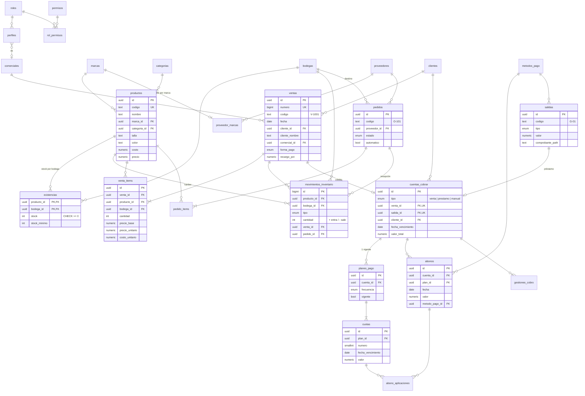

# MER · ZAHO Inventario (Supabase / PostgreSQL)

Script ejecutable: [`supabase/migrations/20261117000001_esquema_inicial.sql`](../supabase/migrations/20261117000001_esquema_inicial.sql)
Datos iniciales: [`supabase/seed.sql`](../supabase/seed.sql)

## Cómo ejecutarlo

**Opción A — Panel de Supabase**
1. Supabase → **SQL Editor** → New query → pega todo el archivo de migración → **Run**.
2. Nueva query → pega `supabase/migrations/20261117000002_eliminar_usuarios.sql` → **Run** (permite eliminar usuarios conservando su historial).
3. Nueva query → pega `supabase/migrations/20261117000003_caja.sql` → **Run** (módulo de Caja: cuentas de dinero, libro de caja, traslados y arqueos; renombra el permiso Salidas → Caja).
4. Nueva query → pega `supabase/migrations/20261117000004_sin_recargo_credito_y_mora.sql` → **Run** (quita el recargo por crédito y agrega el recargo por mora en cartera).
4b. Nueva query → pega `seed.sql` → **Run** (solo configuración y catálogos; se puede repetir sin duplicar).
5. **Authentication → Users → Add user**: crea tu usuario. El **primer** usuario queda como **Administrador**; los demás se crean desde la app (módulo Usuarios).
6. Despliega la Edge Function que crea usuarios (requiere el CLI vinculado al proyecto, ver opción B): `npx supabase functions deploy admin-usuarios`.
7. Recomendado: **Authentication → Providers → Email → desactiva "Allow new users to sign up"**. Aunque alguien se registre por su cuenta, su perfil queda inactivo y sin rol.
8. Verifica: pega [`supabase/verificacion.sql`](../supabase/verificacion.sql) en el SQL Editor → **Run**. Todos los chequeos deben salir ✅.
9. Para **borrar todos los datos** y dejar solo un usuario administrador: [`supabase/limpieza.sql`](../supabase/limpieza.sql) (cambia el correo al inicio del script). No se puede deshacer.

**Opción B — Supabase CLI**
```bash
npx supabase link --project-ref <tu-ref>
npx supabase db push          # aplica supabase/migrations
npx supabase db reset         # (local) aplica migraciones + seed.sql
npx supabase gen types typescript --linked > src/infrastructure/supabase/database.types.ts
```

## Diagrama



## Diccionario de entidades

| Grupo | Tabla | Para qué sirve |
|---|---|---|
| Seguridad | `permisos` | Catálogo fijo módulo × acción (`ventas.crear`, `inventario.editar`…). Lo define el código. |
| | `roles`, `rol_permisos` | Roles creados desde la app con su lista de permisos. `Administrador` (sistema) tiene acceso total. |
| | `perfiles` | Usuario de Supabase Auth + rol + comercial vinculado + activo. |
| Catálogos | `marcas`, `categorias`, `bodegas`, `metodos_pago` | Listas que antes estaban fijas en `constants.ts`. Ahora se administran sin tocar código. |
| | `configuracion` | Fila única: recargo por crédito (10 %), resumen diario, días para "vence pronto". |
| | `plantillas_mensaje` | Textos de WhatsApp (`{nombre}`, `${saldo}`, `{fecha}`). |
| Maestros | `clientes`, `comerciales`, `proveedores`, `proveedor_marcas` | Igual que en la app; cada marca la surte un solo proveedor. |
| Inventario | `productos` | La referencia (código, talla, color, costo, precio). |
| | `existencias` | Stock y mínimo **por bodega**. Reemplaza el duplicar productos al trasladar. |
| | `movimientos_inventario` | Kardex. **El stock solo cambia insertando movimientos** (venta, ajuste, traslado, recepción…). Da trazabilidad completa. |
| Ventas | `ventas`, `venta_items` | Cada ítem guarda precio de lista, precio cobrado (con recargo) y costo del momento → utilidad histórica exacta. |
| Cartera | `cuentas_cobrar` | Unifica crédito de venta, préstamo y deuda manual (restricciones `CHECK` por tipo). |
| | `planes_pago`, `cuotas` | Un plan vigente por cuenta; al rehacer el plan el anterior queda como historial. |
| | `abonos`, `abono_aplicaciones` | Cada abono y cómo se repartió entre las cuotas. |
| | `gestiones_cobro` | Llamadas, WhatsApp, promesas de pago. |
| | `recargos_cartera` | Recargos por mora a cuentas vencidas (porcentaje sobre lo vencido o valor fijo). Suman al saldo y a la cuota atrasada. Las ventas a crédito no llevan recargo. |
| Caja | `cuentas_dinero` | Efectivo, Nequi, bancos… con saldo inicial y fecha de apertura. Cada medio de pago (`metodos_pago.cuenta_id`) entra a una cuenta. |
| | `movimientos_caja` | Otros ingresos, traslados entre cuentas y ajustes de arqueo. Ventas, abonos y salidas NO se copian aquí: el libro (`v_libro_caja`) los toma de su tabla. |
| | `cierres_caja` | Arqueos: saldo del sistema contra dinero contado (con conteo de billetes) y su diferencia. |
| | `salidas` | Gastos y préstamos otorgados; comprobante en Storage (bucket `comprobantes`). |
| Compras | `pedidos`, `pedido_items` | Enviado → Confirmado → Recibido (al recibir suma stock por kardex). |

## Lógica en la base de datos

| Tipo | Nombre | Qué hace |
|---|---|---|
| Trigger | `tg_movimiento_stock` | Aplica cada movimiento a `existencias`; el `CHECK stock >= 0` impide vender sin stock. |
| Trigger | `tg_existencias_pedido_auto` | Si el stock cruza el mínimo y el proveedor está en automático, crea el pedido. |
| Trigger | `tg_auth_nuevo_usuario` | Crea el perfil: el primero es Administrador; los demás toman el rol de `app_metadata` (solo la service key lo escribe). |
| Trigger | `tg_perfiles_admin`, `tg_perfiles_cambios`, `tg_roles_proteger` | Siempre queda un admin activo; nadie cambia su propio rol ni se desactiva; solo un admin asigna administradores; los roles de sistema no se borran. |
| RPC | `mi_sesion()` | Perfil, rol y permisos efectivos del usuario conectado (para el front). |
| RPC | `guardar_rol(...)` | Rol + permisos en una transacción. |
| Edge Function | `admin-usuarios` | Crear usuario, cambiar contraseña, activar/desactivar (usa la service key en el servidor). |
| RPC | `registrar_venta(jsonb)` | Venta + ítems + kardex + cuenta + abono inicial + plan, en una transacción. |
| RPC | `anular_venta(uuid)` | Devuelve el stock y borra la venta (y su cuenta). |
| RPC | `registrar_abono(...)` | Valida saldo y guarda el abono con su reparto por cuotas. |
| RPC | `aplicar_plan(...)` | Reemplaza el plan vigente. |
| RPC | `registrar_prestamo(...)` | Salida + cuenta por cobrar. |
| RPC | `registrar_cuenta_manual(jsonb)` | Deuda manual con abono inicial y plan. |
| RPC | `ajustar_stock`, `trasladar_stock`, `avanzar_pedido`, `crear_producto` | Operaciones de inventario vía kardex. |
| Vista | `v_inventario` | Producto × bodega con estado (disponible / bajo / agotado). |
| Vista | `v_ventas` | Total, costo, utilidad, unidades por venta. |
| Vista | `v_cartera` | Total, pagado, saldo, próxima cuota, días y estado. |
| Vista | `v_flujo_caja` | Ingresos y egresos por fecha para el balance. |

## Seguridad (RLS por permisos)

- Todas las tablas tienen RLS. Leer: cualquier usuario activo, excepto `salidas` (requiere `salidas.ver` o `reportes.ver`) y `perfiles` (el propio o `usuarios.ver`).
- Escribir directo en tablas: `INSERT` → `<módulo>.crear`, `UPDATE` → `<módulo>.editar`, `DELETE` → `<módulo>.eliminar`.
- Las RPC son `security definer` y validan su permiso con `app.exigir()`: por ejemplo `registrar_venta` exige `ventas.crear` y escribe también en cartera e inventario.
- Un usuario sin rol o inactivo no ve ni escribe nada.

| Acción en la app | Permiso |
|---|---|
| Registrar venta / anular venta | `ventas.crear` / `ventas.eliminar` |
| Abono, cuenta manual / plan de pagos | `cartera.crear` / `cartera.editar` |
| Crear producto / ajustar o trasladar stock | `inventario.crear` / `inventario.editar` |
| Confirmar o recibir pedido | `proveedores.editar` |
| Gasto o préstamo | `salidas.crear` |
| Crear usuario / editar usuario o rol / activar-desactivar | `usuarios.crear` / `usuarios.editar` / `usuarios.eliminar` |
